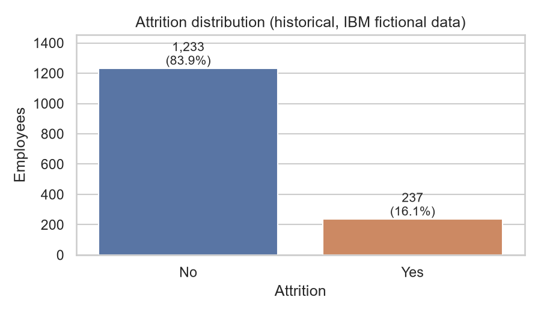

# Data Understanding & Quality Report — Phase 1

Source notebook: `notebooks/01_data_understanding.ipynb` · Column-level table: `reports/data_quality_table.csv`
Dataset: IBM HR Analytics Employee Attrition & Performance (fictional, created by IBM for demonstration).

## 1. Dataset profile

| Check | Result |
|---|---|
| Shape | **1,470 rows × 35 columns** (matches documentation) |
| Encoding | UTF-8 **with BOM** → read with `utf-8-sig`, otherwise the first column becomes `Age` |
| Column types | 26 numeric (7 of them documented ordinal scales), 9 text |
| Missing values | **0** (also 0 disguised missing: empty strings, "NA", "?") |
| Fully duplicated rows | **0** |
| Duplicated `EmployeeNumber` | **0** (1,470 unique IDs, range 1–2068, i.e. non-contiguous) |
| Duplicates ignoring the ID | **0** |
| Out-of-range ordinal codes | **0** |
| Negative values | **0** |

## 2. Target

| Attrition | Employees | Share |
|---|---|---|
| No | 1,233 | 83.88 % |
| Yes | 237 | **16.12 %** |

- Majority-class baseline accuracy = **83.88 %** → a model predicting "nobody leaves" looks accurate but finds zero leavers.
  Accuracy is therefore **not** a success metric for Phase 5.
- No-skill PR-AUC baseline = **0.161** (equal to prevalence). This is the bar the models must clear.
- This is a **cross-sectional snapshot with no observation window**: 16.12 % is historical prevalence in the sample, not an annual turnover rate.

## 3. Logical consistency (business rules)

| Rule | Violations |
|---|---|
| YearsInCurrentRole ≤ YearsAtCompany | 0 |
| YearsWithCurrManager ≤ YearsAtCompany | 0 |
| YearsSinceLastPromotion ≤ YearsAtCompany | 0 |
| YearsAtCompany ≤ TotalWorkingYears | 0 |
| Age − TotalWorkingYears ≥ 14 | 0 |

**Known ambiguity (documented, not "fixed"):** 197 employees have `NumCompaniesWorked = 0` while having more total
working years than company tenure. "0" may mean "current employer is the first" under a different counting convention,
or be a coding quirk. We keep the values as-is and interpret this feature cautiously.

## 4. Column decisions

| Decision | Columns | Evidence |
|---|---|---|
| **Exclude — constant** | `EmployeeCount` (=1), `Over18` (=Y), `StandardHours` (=80) | One unique value each → zero information |
| **Key only** | `EmployeeNumber` | Unique per row; used for joins/exports, never a feature |
| **Audit only — protected** | `Age`, `Gender`, `MaritalStatus` | Excluded from model features; kept for EDA and the Phase 6 fairness audit |
| **Exclude from model — undocumented** | `DailyRate`, `HourlyRate`, `MonthlyRate` | No documented definition, and Spearman ρ with `MonthlyIncome` is 0.02 / −0.02 / 0.05 and with `JobLevel` 0.00 / −0.03 / 0.05. They behave like noise, not pay. Kept in the cleaned file for transparency |
| **Retain, with caveat** | `PerformanceRating` | Documented 1–4 scale, but only values 3 (1,244) and 4 (226) occur → strong ceiling effect, limited information |
| **Retain** | 22 remaining columns | Organizational, compensation, satisfaction, work-condition and career variables |
| **Target** | `Attrition` | Mapped to `AttritionFlag` (1 = Yes) in Phase 2 |

## 5. Redundancy flags (|Spearman ρ| ≥ 0.7)

| Pair | ρ | Implication |
|---|---|---|
| JobLevel – MonthlyIncome | 0.92 | Seniority and pay are almost the same signal; LR coefficients split between them |
| YearsAtCompany – YearsInCurrentRole | 0.85 | Tenure variables overlap |
| YearsAtCompany – YearsWithCurrManager | 0.84 | " |
| JobLevel – TotalWorkingYears | 0.74 | " |
| YearsInCurrentRole – YearsWithCurrManager | 0.73 | " |
| MonthlyIncome – TotalWorkingYears | 0.71 | " |

These are not removed automatically. They matter for **interpreting** Logistic Regression coefficients and SHAP
importance (credit can be shared or shifted between correlated features). Regularization handles the numerical side.

## 6. Protected attributes and proxy risk

Removing `Age` does not remove age information. Retained features most correlated with Age:

| Feature | Spearman ρ with Age |
|---|---|
| TotalWorkingYears | **0.66** |
| JobLevel | 0.49 |
| MonthlyIncome | 0.47 |
| NumCompaniesWorked | 0.35 |

→ The model can partly reconstruct age. Phase 6 must therefore audit by age band, not just assert that Age was excluded.

Protected group sizes (affects the precision of fairness estimates):

| Group | n | Leavers | Attrition rate |
|---|---|---|---|
| Female | 588 | 87 | 14.8 % |
| Male | 882 | 150 | 17.0 % |
| Single | 470 | 120 | 25.5 % |
| Married | 673 | 84 | 12.5 % |
| Divorced | 327 | 33 | 10.1 % |

On a 30 % test split, the smallest groups will have only ~10 leavers → wide confidence intervals in Phase 6.

## 7. Implications for the next phases
1. **Phase 2:** drop the 3 constants; build model features without IDs, protected attributes and undocumented rates.
2. **Phase 4:** report attrition **rates with group sizes** (e.g. HR department n = 63).
3. **Phase 5:** stratified split, class weighting, PR-AUC as the main metric, regularized LR.
4. **Phase 6:** audit Gender, MaritalStatus and Age band, with confidence intervals, and discuss the TotalWorkingYears proxy.
